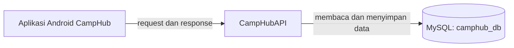
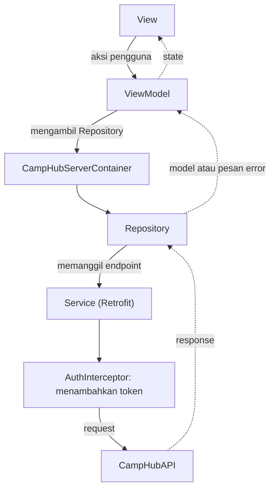
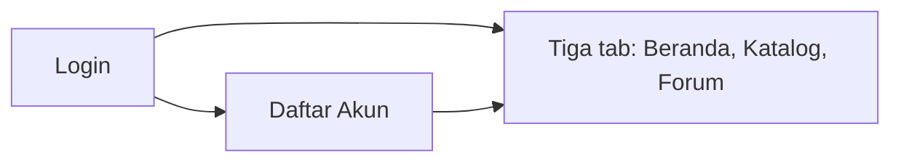
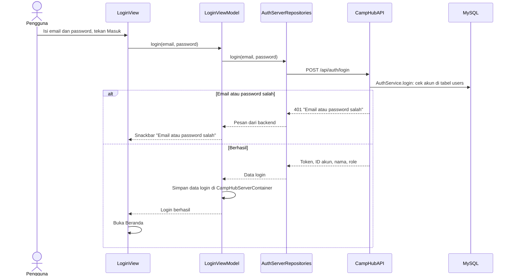
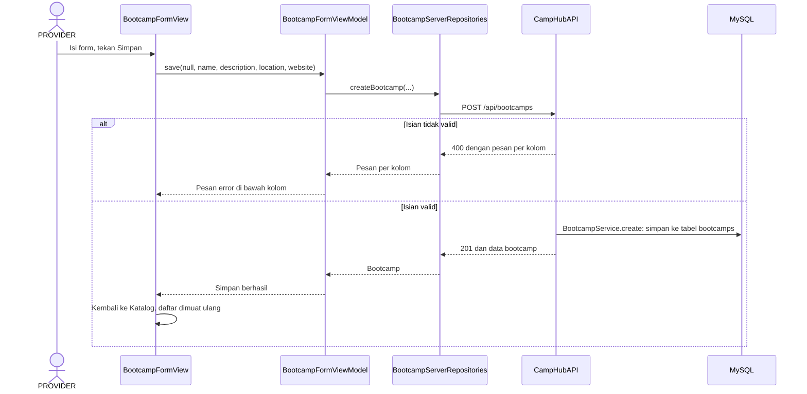
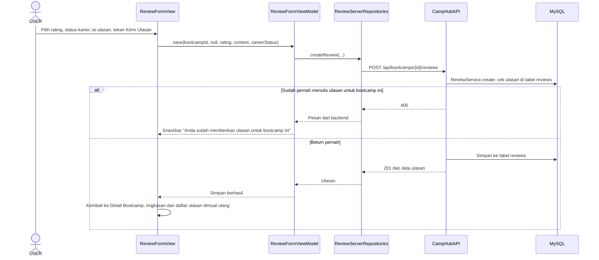
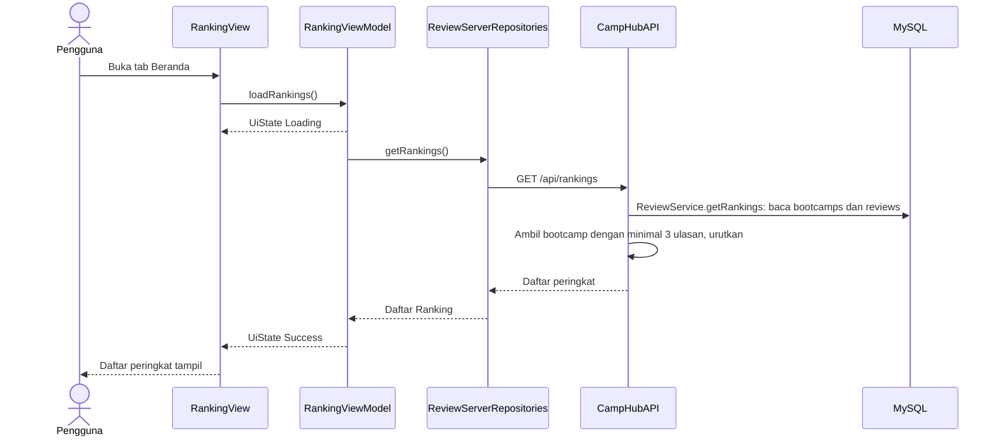
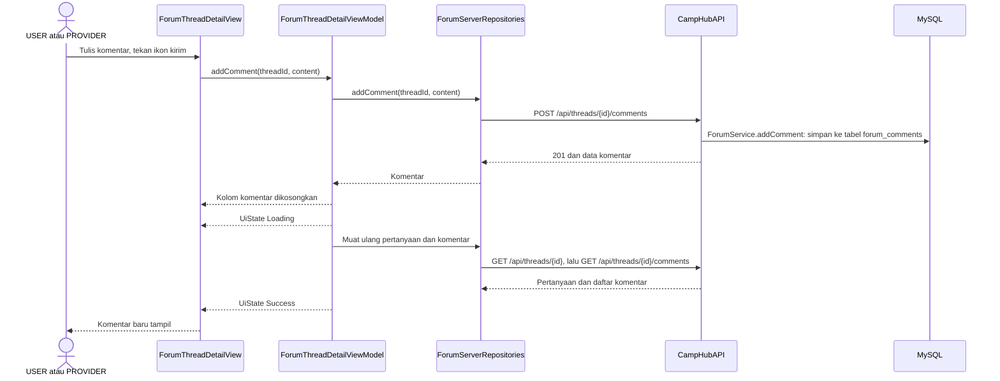

# Arsitektur CampHub

Dokumen ini menjelaskan bagian-bagian aplikasi Android, navigasi antarlayar, dan alur setiap fitur dari layar sampai database. Fitur dan cara menjalankan aplikasi ada di [README](../README.md). Bagian backend dan struktur database ada di [arsitektur CampHubAPI](https://github.com/ixlumine/CampHubAPI/blob/main/docs/ARCHITECTURE.md).

## Istilah

| Istilah | Arti |
|---|---|
| Request | Permintaan yang dikirim aplikasi ke backend, misalnya meminta daftar bootcamp |
| Response | Jawaban backend dalam format JSON |
| Token | Kode yang diterima saat register atau login. Dikirim lewat header `Authorization: Bearer <token>` pada request berikutnya. Berlaku 24 jam |
| Role | Jenis akun: USER, PROVIDER, atau ADMIN |
| View | Layar dan komponen Composable |
| ViewModel | Menyimpan dan menyediakan state untuk UI |
| UiState | UI state (Loading, Success, Error) |
| Repository | Mengambil data dari API dan mengubahnya menjadi model |
| Service | Di aplikasi: daftar endpoint API (interface Retrofit). Di backend: logika bisnis, misalnya `ReviewService` |

## Hubungan antarbagian

- Alamat backend diambil dari `camphub.baseUrl` di `local.properties`. Jika tidak diisi, alamatnya `http://10.0.2.2:8080/` (lihat README bagian Konfigurasi).
- Semua data diambil dari backend. Aplikasi tidak menyimpan data di HP.

## Lapisan aplikasi

Aplikasi dibagi menjadi UI layer dan data layer.

Garis putus-putus menunjukkan arah data kembali ke layar. State berisi UiState untuk layar yang memuat data, serta status loading, pesan error, dan pesan per kolom untuk layar Login, Daftar Akun, dan form.

| Folder | Lapisan | Tugas |
|---|---|---|
| `ui/view/` | UI layer | Layar dan komponen Composable |
| `ui/viewmodel/` | UI layer | Menyimpan dan menyediakan state untuk UI |
| `ui/state/` | UI layer | UI state (Loading, Success, Error) |
| `ui/model/` | UI layer | Model data untuk ditampilkan |
| `ui/route/` | UI layer | Route dan NavHost |
| `data/repository/` | Data layer | Mengambil data dari API dan mengubahnya menjadi model |
| `data/service/` | Data layer | Daftar endpoint API (interface Retrofit) |
| `data/dto/` | Data layer | Data Transfer Object untuk request dan response API |
| `data/interceptor/` | Data layer | Menambahkan header `Authorization: Bearer <token>` |
| `data/container/` | Data layer | Pembuatan Retrofit dan data login (token, user, role) |

## Sesi login

- Setelah register atau login berhasil, token, ID akun, role, dan nama disimpan di `CampHubServerContainer`.
- ViewModel membuat `CampHubServerContainer` baru setiap kali mengambil data. `AuthInterceptor` lalu menambahkan token yang sedang tersimpan ke setiap request.
- Data login hanya disimpan selama aplikasi berjalan. Setelah aplikasi ditutup, pengguna perlu login lagi.
- **Keluar** (menu akun di Beranda, Katalog, dan Forum) menghapus data login dan membuka layar Login.
- Jika token sudah kedaluwarsa (lebih dari 24 jam), backend menolak request (401) dan layar menampilkan pesan error. Aplikasi tidak membuka layar Login secara otomatis, jadi pengguna perlu keluar lalu login lagi.

## Navigasi

| Layar | Judul di aplikasi | Dibuka dari | Membuka |
|---|---|---|---|
| Login | CampHub | Saat aplikasi dibuka, Keluar | Daftar Akun, Beranda |
| Daftar Akun | Daftar Akun | Login | Beranda |
| Beranda | Peringkat Bootcamp | Login, Daftar Akun, tab | Detail Bootcamp |
| Katalog | Katalog Bootcamp | Tab | Detail Bootcamp, Form Bootcamp (tambah) |
| Forum | Forum | Tab | Detail Pertanyaan, Form Pertanyaan (buat) |
| Detail Bootcamp | Detail Bootcamp | Beranda, Katalog | Form Bootcamp (ubah), Detail Program, Form Program (tambah), Form Ulasan (tulis dan ubah) |
| Detail Program | Detail Program | Detail Bootcamp | Form Program (ubah) |
| Detail Pertanyaan | Diskusi | Forum | Form Pertanyaan (ubah) |
| Form Bootcamp | Tambah Bootcamp, Ubah Bootcamp | Katalog, Detail Bootcamp | Tidak ada |
| Form Program | Tambah Program, Ubah Program | Detail Bootcamp, Detail Program | Tidak ada |
| Form Ulasan | Tulis Ulasan, Ubah Ulasan | Detail Bootcamp | Tidak ada |
| Form Pertanyaan | Buat Pertanyaan, Ubah Pertanyaan | Forum, Detail Pertanyaan | Tidak ada |

- Aplikasi dibuka di layar Login. Setelah register atau login, aplikasi membuka Beranda, dan layar Login serta Daftar Akun dihapus dari riwayat.
- Tombol kembali di tab Katalog dan Forum membuka Beranda.
- Form dipakai untuk tambah dan ubah. Setelah data disimpan, aplikasi kembali ke layar sebelumnya.

## Status layar dan error

| Kondisi | Yang tampil |
|---|---|
| Data sedang dimuat | Indikator loading |
| Data gagal dimuat | Pesan error dan tombol **Coba Lagi** |
| Backend tidak dapat dihubungi | Pesan "Tidak dapat terhubung ke server" |
| Isian form tidak valid | Pesan error di bawah kolom yang salah |
| Error lain saat menyimpan atau menghapus | Pesan dari backend di Snackbar |

Setiap layar memuat ulang datanya saat dibuka atau saat pengguna kembali ke layar tersebut.

## Alur per fitur

Setiap fitur memiliki satu diagram untuk aksi utama dan satu tabel untuk semua aksi. Kolom **Diproses di backend** menyebut fungsi Service backend di CampHubAPI dan tabel utama yang dibaca atau diubah. Nama pembuat data diambil dari tabel `users`.

### Autentikasi

| Aksi pengguna | Layar | Fungsi ViewModel | Endpoint | Diproses di backend | Hasil di layar |
|---|---|---|---|---|---|
| Register | Daftar Akun | `RegisterViewModel.register` | `POST /api/auth/register` | `AuthService.register`, tabel `users` | Beranda terbuka. Akun baru memiliki role USER |
| Login | Login | `LoginViewModel.login` | `POST /api/auth/login` | `AuthService.login`, tabel `users` | Beranda terbuka |
| Keluar | Menu akun | Tidak ada (`AppRouting`) | Tidak ada | Tidak ada | Data login dihapus, layar Login terbuka |

### Katalog

| Aksi pengguna | Layar | Fungsi ViewModel | Endpoint | Diproses di backend | Hasil di layar |
|---|---|---|---|---|---|
| Buka tab Katalog | Katalog | `BootcampListViewModel.loadBootcamps` | `GET /api/bootcamps` | `BootcampService.list`, tabel `bootcamps` | Daftar bootcamp, diurutkan berdasarkan nama (A–Z) |
| Buka detail bootcamp | Detail Bootcamp | `BootcampDetailViewModel.loadBootcamp` | `GET /api/bootcamps/{id}`, lalu `GET /api/bootcamps/{id}/programs` | `BootcampService.get` dan `ProgramService.listByBootcamp`, tabel `bootcamps` dan `programs` | Profil bootcamp dan daftar program. Ringkasan ulasan dan daftar ulasan dimuat terpisah (lihat Ulasan) |
| Tambah bootcamp | Form Bootcamp | `BootcampFormViewModel.save` | `POST /api/bootcamps` | `BootcampService.create`, tabel `bootcamps` | Kembali ke Katalog |
| Ubah bootcamp | Form Bootcamp | `BootcampFormViewModel.loadBootcamp`, lalu `save` | `GET /api/bootcamps/{id}`, lalu `PUT /api/bootcamps/{id}` | `BootcampService.update`, tabel `bootcamps` | Kembali ke Detail Bootcamp |
| Hapus bootcamp | Detail Bootcamp | `BootcampDetailViewModel.deleteBootcamp` | `DELETE /api/bootcamps/{id}` | `BootcampService.delete`, tabel `bootcamps` | Kembali ke layar sebelumnya. Jika bootcamp masih memiliki program atau ulasan, pesan dari backend tampil di Snackbar |
| Buka detail program | Detail Program | `ProgramDetailViewModel.loadProgram` | `GET /api/programs/{id}`, lalu `GET /api/bootcamps/{bootcampId}` | `ProgramService.get` dan `BootcampService.get`, tabel `programs` dan `bootcamps` | Detail program. Data bootcamp dipakai untuk mengecek apakah akun yang login adalah PROVIDER yang membuat bootcamp tersebut |
| Tambah program | Form Program | `ProgramFormViewModel.save` | `POST /api/bootcamps/{id}/programs` | `ProgramService.create`, tabel `programs` | Kembali ke Detail Bootcamp. Harga dan durasi yang bukan angka ditolak di aplikasi sebelum dikirim |
| Ubah program | Form Program | `ProgramFormViewModel.loadProgram`, lalu `save` | `GET /api/programs/{id}`, lalu `PUT /api/programs/{id}` | `ProgramService.update`, tabel `programs` | Kembali ke Detail Program |
| Hapus program | Detail Program | `ProgramDetailViewModel.deleteProgram` | `DELETE /api/programs/{id}` | `ProgramService.delete`, tabel `programs` | Kembali ke Detail Bootcamp |

### Ulasan

| Aksi pengguna | Layar | Fungsi ViewModel | Endpoint | Diproses di backend | Hasil di layar |
|---|---|---|---|---|---|
| Lihat ringkasan ulasan | Detail Bootcamp | `ReviewSummaryViewModel.loadSummary` | `GET /api/bootcamps/{id}/review-summary` | `ReviewService.getSummary`, tabel `reviews` | Rata-rata rating, jumlah ulasan, dan jumlah ulasan per status karier. Jika gagal dimuat, kartu ringkasan tidak ditampilkan |
| Lihat daftar ulasan | Detail Bootcamp | `BootcampReviewViewModel.loadReviews` | `GET /api/bootcamps/{id}/reviews` | `ReviewService.listByBootcamp`, tabel `reviews` | Daftar ulasan bootcamp |
| Tulis ulasan | Form Ulasan | `ReviewFormViewModel.loadForm`, lalu `save` | `GET /api/bootcamps/{id}`, lalu `POST /api/bootcamps/{id}/reviews` | `ReviewService.create`, tabel `reviews` | Kembali ke Detail Bootcamp. Tombol Kirim Ulasan aktif setelah isi ulasan diisi |
| Ubah ulasan | Form Ulasan | `ReviewFormViewModel.loadForm`, lalu `save` | `GET /api/bootcamps/{id}` dan `GET /api/bootcamps/{id}/reviews`, lalu `PUT /api/reviews/{id}` | `ReviewService.update`, tabel `reviews` | Kembali ke Detail Bootcamp |
| Hapus ulasan | Detail Bootcamp | `BootcampReviewViewModel.deleteReview` | `DELETE /api/reviews/{id}` | `ReviewService.delete`, tabel `reviews` | Daftar ulasan dimuat ulang. Ringkasan ulasan baru diperbarui saat Detail Bootcamp dibuka lagi. Jika penghapusan gagal, pesan error tidak ditampilkan |

### Peringkat

| Aksi pengguna | Layar | Fungsi ViewModel | Endpoint | Diproses di backend | Hasil di layar |
|---|---|---|---|---|---|
| Buka Beranda | Beranda | `RankingViewModel.loadRankings` | `GET /api/rankings` | `ReviewService.getRankings`, tabel `bootcamps` dan `reviews` | Bootcamp dengan minimal 3 ulasan, diurutkan dari rata-rata rating tertinggi (dibulatkan 1 desimal), lalu jumlah ulasan terbanyak |
| Pilih bootcamp | Beranda | Tidak ada | Tidak ada | Tidak ada | Detail Bootcamp terbuka |

### Forum

| Aksi pengguna | Layar | Fungsi ViewModel | Endpoint | Diproses di backend | Hasil di layar |
|---|---|---|---|---|---|
| Buka tab Forum | Forum | `ForumListViewModel.loadThreads` | `GET /api/threads` | `ForumService.listThreads`, tabel `forum_threads` dan `forum_comments` (jumlah komentar) | Daftar pertanyaan, yang terbaru di atas |
| Buka detail pertanyaan | Detail Pertanyaan | `ForumThreadDetailViewModel.loadThreadDetail` | `GET /api/threads/{id}`, lalu `GET /api/threads/{id}/comments` | `ForumService.getThread` dan `ForumService.listComments`, tabel `forum_threads` dan `forum_comments` | Pertanyaan dan daftar komentar |
| Buat pertanyaan | Form Pertanyaan | `ForumThreadFormViewModel.save` | `POST /api/threads` | `ForumService.createThread`, tabel `forum_threads` | Kembali ke Forum |
| Ubah pertanyaan | Form Pertanyaan | `ForumThreadFormViewModel.loadThread`, lalu `save` | `GET /api/threads/{id}`, lalu `PUT /api/threads/{id}` | `ForumService.updateThread`, tabel `forum_threads` | Kembali ke Detail Pertanyaan |
| Hapus pertanyaan | Detail Pertanyaan | `ForumThreadDetailViewModel.deleteThread` | `DELETE /api/threads/{id}` | `ForumService.deleteThread`, tabel `forum_comments` dan `forum_threads` | Kembali ke Forum. Menghapus pertanyaan ikut menghapus komentarnya |
| Kirim komentar | Detail Pertanyaan | `ForumThreadDetailViewModel.addComment` | `POST /api/threads/{id}/comments` | `ForumService.addComment`, tabel `forum_comments` | Kolom komentar dikosongkan, pertanyaan dan komentar dimuat ulang. Ikon kirim aktif setelah komentar diisi |
| Hapus komentar | Detail Pertanyaan | `ForumThreadDetailViewModel.deleteComment` | `DELETE /api/comments/{id}` | `ForumService.deleteComment`, tabel `forum_comments` | Pertanyaan dan komentar dimuat ulang |

## Tombol sesuai role

Aplikasi menampilkan tombol berdasarkan role dan ID akun yang sedang login. Backend tetap memeriksa hak akses setiap request.

| Tombol | Tampil untuk |
|---|---|
| Tambah Bootcamp (Katalog) | PROVIDER |
| Ubah (Detail Bootcamp) | PROVIDER yang membuat bootcamp tersebut |
| Tambah Program (Detail Bootcamp) | PROVIDER yang membuat bootcamp tersebut |
| Hapus (Detail Bootcamp) | PROVIDER yang membuat bootcamp tersebut, dan ADMIN |
| Ubah (Detail Program) | PROVIDER yang membuat bootcamp dari program tersebut |
| Hapus (Detail Program) | PROVIDER yang membuat bootcamp dari program tersebut, dan ADMIN |
| Tulis Ulasan | Semua USER, termasuk yang sudah menulis ulasan untuk bootcamp tersebut |
| Ubah (kartu ulasan) | USER yang menulis ulasan tersebut |
| Hapus (kartu ulasan) | USER yang menulis ulasan tersebut, dan ADMIN |
| Buat Pertanyaan (Forum), kolom komentar (Detail Pertanyaan) | USER dan PROVIDER |
| Ubah (Detail Pertanyaan) | Akun yang menulis pertanyaan tersebut |
| Hapus (Detail Pertanyaan) | Akun yang menulis pertanyaan tersebut, dan ADMIN |
| Hapus (komentar) | Akun yang menulis komentar tersebut, dan ADMIN |

Hak akses setiap endpoint ada di [README CampHubAPI bagian Endpoint](https://github.com/ixlumine/CampHubAPI#endpoint).
